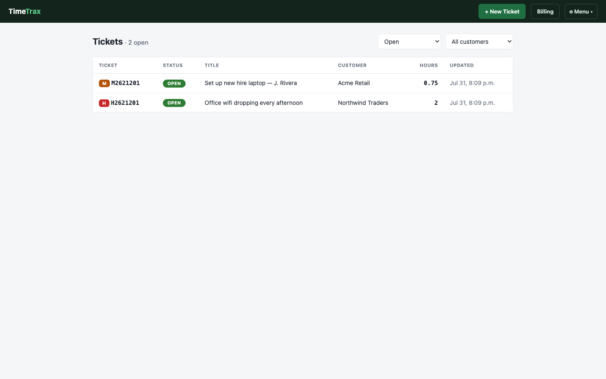
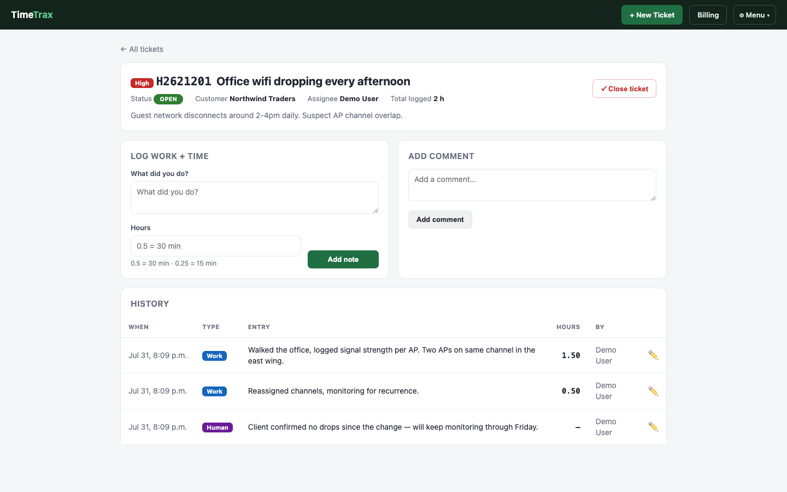
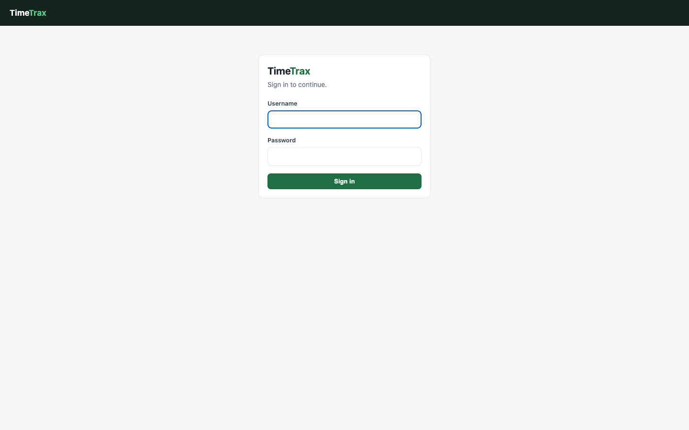
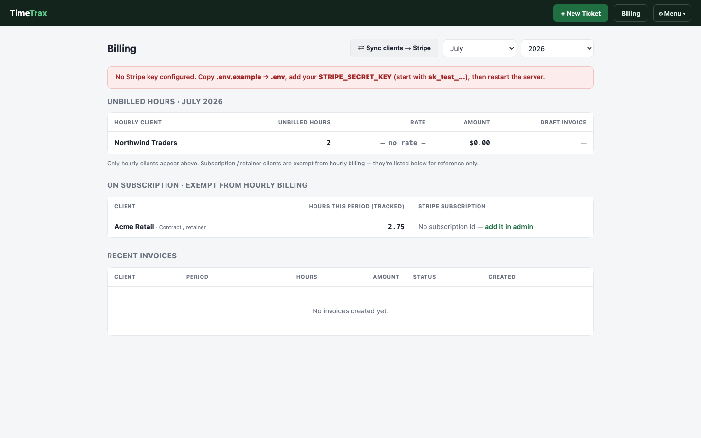

# TimeTrax

A self-hosted ticket + time-tracking web app, built on Django. Create a ticket,
log work notes with hours as you go, close it out, and hours auto-sum into
billable time per client. Includes Stripe integration for turning logged hours
into draft invoices, plus an n8n hook for AI-assisted ticket triage.

> Screenshots below use seeded demo data — no real client info.

| | |
|---|---|
|  |  |
|  |  |

## Features

- Tickets (`Item`) with priority, status, assignee, and a merged activity
  timeline of comments + work notes
- `WorkNote` hour logging that sums to total billable time on close
- Per-client billing mode (`contract`/`retainer` vs `hourly`)
- Stripe billing: draft invoices generated from unbilled hourly work, reviewed
  before sending — never auto-sent
- REST API (Bearer token auth) for external tools/automation to read/create
  tickets and post comments
- n8n integration: new tickets fire a webhook for AI triage (classification,
  priority, suggested action) — see [n8n integration](#n8n-integration) below
- `scripts/tt` — CLI for querying/managing tickets without the web server
- Django admin with a full activity timeline

## Setup

```bash
python -m venv .venv
source .venv/bin/activate        # Windows: .venv\Scripts\activate
pip install -r requirements.txt

cp .env.example .env
# then edit .env: set DJANGO_SECRET_KEY, STRIPE_SECRET_KEY (test key), TIMETRAX_API_KEY

python manage.py migrate
python manage.py createsuperuser
python manage.py runserver 127.0.0.1:8000
```

Then visit `http://127.0.0.1:8000/`.

## Project layout

- `config/` — Django project settings, URL routing
- `tickets/` — the app: models, views, admin, billing, REST API, templates
- `scripts/tt` — standalone CLI (`tt list`, `tt show <id>`, `tt work <id> <hours> "..."`, etc.)
- `scripts/setup_n8n_triage.sh` — optional n8n workflow for AI-assisted ticket triage over the REST API

## Stripe billing

Requires a `STRIPE_SECRET_KEY` in `.env` (start with a `sk_test_...` key). The
`Billing` page gathers an hourly client's unbilled work notes for a month into
one **draft** Stripe invoice — nothing sends to a client without you reviewing
it in the Stripe dashboard first.

## REST API

Endpoints under `/api/tickets/` accept a `Bearer <TIMETRAX_API_KEY>` header
(see `.env.example`). Used for external automation to read tickets, create
tickets, and post comments.

## n8n integration

Every new ticket fires a webhook (`tickets/signals.py`, `post_save` on `Item`)
to a local n8n instance for AI-powered triage — classification, priority
assessment, and a suggested first action, posted back as a ticket comment via
the REST API. It's fire-and-forget: if n8n isn't running, ticket creation
still succeeds and the failure is just logged.

- Webhook target: `N8N_TICKET_WEBHOOK` env var, defaults to
  `http://127.0.0.1:5678/webhook/timetrax-triage`
- `scripts/setup_n8n_triage.sh` — spins up n8n via Docker Compose and installs
  the triage workflow (webhook → AI classifier → auto-comment back on the
  ticket). Requires Docker and `TIMETRAX_API_KEY` set in your environment.

```bash
export TIMETRAX_API_KEY=your-key-here
./scripts/setup_n8n_triage.sh
cd scripts/n8n && docker compose up -d
```

Then set your OpenAI key in n8n's environment variables and activate the
"TimeTrax AI Ticket Triage" workflow.
